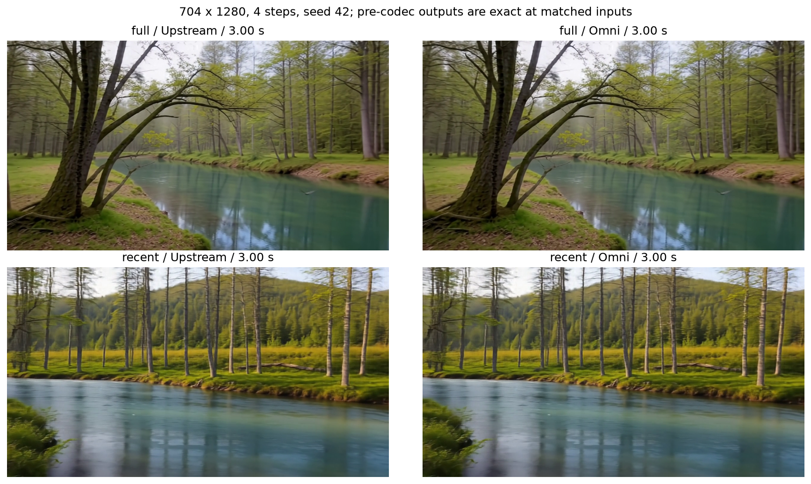
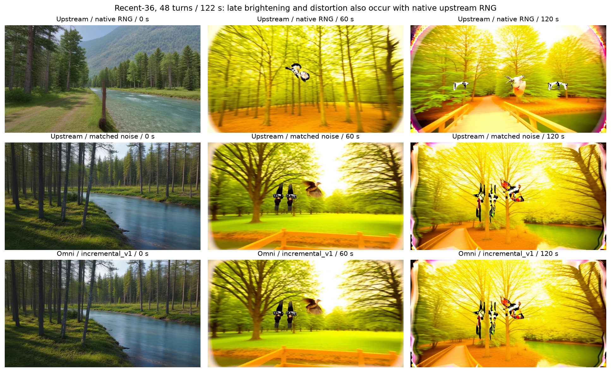
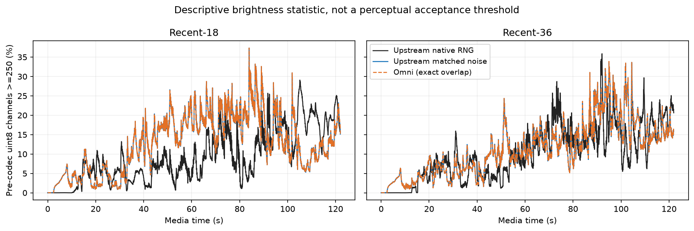

# Hy-Nomas: reference accuracy, generated videos and measured performance

Evidence for PR #9338. Model implementation: `2097719014bd540333d661ae3873ac1f6c00ffc4`; the precision campaign used `72ff85c6365f22599ad7958743d7dd71212cd2e3`, with only documentation uncommitted. All model weights and computations were real. The reported recent-history budgets are **18 and 36**; the interrupted 72-budget campaign is excluded and was not retried.

## Accuracy and entrypoint consistency

One H200, BF16, resident weights, FlexAttention, SP1, 704×1280, 24 fps, seed 42, CFG=1, flow shift=5. Each accuracy case ran once. Models were loaded in separate processes.

| Comparison | Workload | Result |
| --- | --- | --- |
| Full vs upstream | Three 49-frame turns, separately at 4 and 8 steps | All complete latents exact; all pre-codec uint8 video exact |
| Recent vs upstream | Same turns/steps, budget 36, same actual incremental-v1 noise | Exact at every turn, including history eviction and camera changes |
| Offline AR vs realtime, full | 129 frames, 4 steps, two generation blocks | Latents and pre-codec pixels exact; encoded frame count and PTS correct |
| Offline AR vs realtime, recent | 129 frames, budget 18, two prompt segments and camera switching | Same exact result |
| Recent long rollout vs upstream | Budgets 18/36, 48×61=2928 frames, 122 s, 4 steps | All 48 turns have exact latents and identical pre-codec video SHA-256 |

The current implementation also passed 234 related CPU checks, 34 pinned PixelUMM CPU checks, and four isolated resident/offload continuation/tail-reference cases. These counts describe separate suites and are not summed with historical results.

Data: [accuracy audit](data/accuracy.json), [individual comparisons](data/comparisons), [per-turn video hashes](data/precodec-hashes.json), [revisions and software](data/manifest.json).

### RNG and reference boundaries

`full` preserves the configured upstream fixed-duration noise timeline and shared KV-perturbation RNG. `recent` uses `incremental_v1`: frame-major CPU generation noise and a separate KV-perturbation generator. Identical seeds therefore do not imply identical random inputs across these two algorithms.

Recent precision tests supply the upstream inference pipeline with the same actual incremental-v1 generation and KV-perturbation noise used by Omni. The upstream model, scheduler and recent-history policy remain the oracle. This proves agreement at equal random inputs; it does **not** claim same-seed agreement with the unchanged upstream RNG. The separate `native-noise` videos keep the upstream RNG unchanged.

Recent reference comparisons use upstream's supported `seg_ar` mode and equal generation boundaries. An additional 193-frame, same-segment `recent + chunk_ar` probe stopped in upstream at the second cache write with `SWA requires a masked segment-AR cache write`; there is no complete oracle for that combination. It is not counted as a passed comparison. Omni same-request multi-block behavior is separately checked through offline AR/realtime consistency.

## Generated output and long-horizon appearance

Short comparisons show upstream on the left and Omni on the right. Labels and recompression are for viewing; metrics use complete outputs before MP4 encoding.



| Viewing copy | Duration | Description |
| --- | --- | --- |
| [Full reference / Omni](media/full-comparison.mp4) | 147 frames / 6.125 s | Four-step full-history continuation |
| [Recent reference / Omni](media/recent-comparison.mp4) | 147 frames / 6.125 s | Same actual noise, camera and prompt changes |
| [Offline AR / realtime](media/offline-realtime-recent.mp4) | 129 frames / 5.375 s | Recent mode, two text/camera segments |
| [Long recent-18 reference / Omni](media/long-matched-18.mp4) | 2928 frames / 122 s | Complete matching rollout |
| [Long recent-36 reference / Omni](media/long-matched-36.mp4) | 2928 frames / 122 s | Complete matching rollout |
| [Upstream native RNG, recent-18](media/upstream-native-18.mp4) | 2928 frames / 122 s | Independent native-noise appearance control |
| [Upstream native RNG, recent-36](media/upstream-native-36.mp4) | 2928 frames / 122 s | Independent native-noise appearance control |

**Late overexposure, yellowing and distortion also appear in the upstream native-noise runs.** At equal actual noise, the reported 18/36 Omni rollouts are pixel-identical to the upstream reference. This establishes the symptom in upstream for this scene; it does not identify its mechanism or establish broad long-horizon quality.



| Native-noise upstream | Mean channel value, first / last 5 s | Channels ≥250, first / last 5 s |
| --- | --- | --- |
| recent-18 | 98.28 / 134.39 | 0.00052% / 20.18% |
| recent-36 | 98.29 / 149.36 | 0.00052% / 20.17% |

These are descriptive statistics from pre-codec uint8 channels, not an approved perceptual pass threshold. Whole-video dimensions/PTS and time-spanning samples were checked. Coverage is one forest/river scene and one seed. The long sequence has 48 successive 61-frame turns and fixed prompt/camera changes at turns 3,5,…,41; its per-turn cropping differs from the separate 2881-frame WebSocket diagnostic below.



Raw values: [frame-brightness.csv](data/frame-brightness.csv). Matched reference and Omni curves overlap exactly.

## Current long-stream diagnostic

Implementation `209771901`; two H200s, SP2, resident BF16, eager/mp, 704×1280, 2881 frames at 24 fps, 4 steps, seed 42, 20 prompt/camera updates, nominal 16-latent blocks with a final merged 17-latent block. **One diagnostic session per budget; no matching warmup excluded.**

| History budget | First playable frame (ms) | Client E2E (ms) | RTF | Peak allocated / reserved per GPU (GiB) |
| --- | --- | --- | --- | --- |
| 18 | 17175.3 | 538357.1 | 4.485 | 64.80 / 67.40 |
| 36 | 19042.5 | 554444.1 | 4.619 | 72.30 / 74.79 |

Timing excludes model startup and includes controls, encoding, disk writes, client decode and worker observations; compilation effects are not excluded. These are functional diagnostics, not a steady-state benchmark. There was no equivalent timing collection in the 122-second precision campaign.

History uses a shared video/text token budget: the observed maxima were 15360/15840 and 31680/31680 tokens. The rolling decoder retained at most 19 latents and one active mapping record. Per-GPU counters were equal across ranks. Details, early/middle/late chunk intervals and control positions are in [long-stream-diagnostic.json](data/long-stream-diagnostic.json).

## Historical repeated SDK benchmark

These measurements belong to implementation `257856d3afce694803f83fd60674f292b7a34583`, before the bounded-history integration. They have **not** been remeasured on `209771901`. Workload: 704×1280, 121 frames, 8 steps, BF16, seed 42, batch/concurrency=1; two exact-shape warmups followed by five measured requests per configuration, on the same H200 pair.

| GPUs / SP | Module CPU offload | Median E2E (ms) | Mean ± SD (ms) | Nearest-rank p95 (ms) | Peak allocated / reserved per GPU (GiB) |
| --- | --- | --- | --- | --- | --- |
| 1 / 1 | no | 30894.7 | 32602.0 ± 7422.3 | 44070.2 | 59.09 / 63.37 |
| 2 / 2 | no | 21123.7 | 21173.7 ± 198.2 | 21497.7 | 53.05 / 57.06 |
| 1 / 1 | yes | 41248.6 | 41361.2 ± 3601.0 | 46637.9 | 30.56 / 32.07 |
| 2 / 2 | yes | 38466.6 | 39800.6 ± 2961.5 | 44121.6 | 23.80 / 25.99 |

SDK E2E is `Omni.generate` start to complete CPU output. It excludes model loading, encoding, writes, hashing and memory RPCs. The SP1 recheck median was 25669.2 ms, a **−16.91%** baseline change on the shared host; apparent differences of similar magnitude are provisional. With five samples, nearest-rank p95 is the maximum. The observed SP2/SP1 median ratio was 1.463× for this run.

[Raw samples, original manifest and benchmark commands](https://github.com/wtz2333/vllm-omni/blob/a518affb28c71bf072bae2e4397dd5f227822e75/test-evidence/PR9338/hy-nomas-diffusers/README.md), [machine-readable summary](data/historical-performance.json).

### Calculations

- Media duration = delivered frames / playback fps: `2928/24=122 s`, `2881/24=120.0417 s`.
- RTF = client E2E / media duration; values above 1 mean generation takes longer than playback.
- Speedup = baseline median / candidate median; latency reduction = `1 − candidate/baseline`.
- Historical serial frame rate = `121 / mean_E2E_seconds`; it is not saturated throughput.
- Near-white fraction = number of uint8 channels ≥250 / all channels, averaged over the specified frames.

## Implementation and qualification boundaries

- Entry points: ordinary offline generation, AR-session offline generation, `/v1/videos`, and normal `/v1/realtime/video` generation with prompt/camera updates and stable final flush.
- `recent` is an AR-session setting. The ordinary offline pipeline retains full-history behavior; use the session example or recent deployment to enable recent history.
- Default: BF16, full history, 8 steps. Tested parallel layouts are SP1/SP2; module CPU offload has separate historical and committed-test evidence. Current long recent comparisons are resident/SP1.
- Runtime math depends on pinned `wtz2333/Hy-Nomas@16a4c228fd6f4770ed4a111b360031f7686c4a19`; Omni owns component loading, AR scheduling/KV state and output handling.
- Current API accepts `4*n+1` frames, although PixelUMM itself expands four video frames per latent and crops. Realtime fixes the total requested length at session start; cumulative turn addition uses typed ticks. Camera inputs are trajectories/JSON/NPZ, rather than a direct `norm_extrinsics` field.
- Reported recent-history precision covers budgets 18/36. Budget 72 is unqualified. Production service hardening, compute-mid-generation cancellation and real blocked TCP sending are outside this integration's acceptance scope. GPU CI and a matched 240-frame SGLang comparison have not run.

## Reproduce precision and entrypoint comparisons

Use the tested Omni implementation and the pinned reference runtime from its recipe. Set paths to the candidate and native checkpoints; run from the Omni source root, keeping this bundle outside it. One H200 and the bundled Python dependencies are required (`av`, `httpx`, `websockets`, `PyYAML`, `safetensors`); install the matching vLLM 0.32 environment described by the recipe.

```bash
export VLLM_OMNI_SOURCE="$PWD"
export HY_NOMAS_MODEL=/path/to/Hy-Nomas-Diffusers
export HY_NOMAS_REFERENCE_MODEL=/path/to/Hy-Nomas
export EVIDENCE_SCRIPTS=/path/to/this-bundle/scripts
export PYTHONPATH="$VLLM_OMNI_SOURCE:$EVIDENCE_SCRIPTS:$PYTHONPATH"
# Full: omit --compact to retain decoded arrays as well as latents.
for role in reference candidate compare; do
  python "$EVIDENCE_SCRIPTS/parity.py" --worker "$role" --history full \
    --noise native --height 704 --width 1280 --steps 4 --turns 3 \
    --frames 49 --capacity 48 --compact --output /path/to/new-full
done
```

For recent short precision, use `--history recent --noise incremental_v1 --budget 36`; repeat with `--steps 8` for compatibility. For the 122-second matched case, use `--turns 48 --frames 61 --capacity 768 --timeline long --budget 18` (or 36). For the independent native-noise control, run **only** `--worker reference --noise native` in a separate output directory. These switches are exactly those recorded by the campaign; no model forward or cache implementation is substituted.

```bash
for role in offline realtime compare; do
  python "$EVIDENCE_SCRIPTS/transport.py" --worker "$role" --history recent \
    --demo segments --height 704 --width 1280 --frames 129 --capacity 48 \
    --output /path/to/new-transport
done
```

For full transport, use `--history full --demo plain`. The observation extension records actual outputs and exposes a localhost diagnostic RPC; it does not replace model computation. The published scripts only parameterize the original harness's source/server paths; parity math is unchanged. Use scheduler-managed GPU allocation on shared machines. The instrumented scripts do not produce authoritative performance timings.

Source weights: Tencent Hunyuan. Codex assisted with implementation, experiments and reporting. Generated media are model outputs for validation. Published videos are scaled/recompressed viewing copies and do not participate in numerical metrics.
