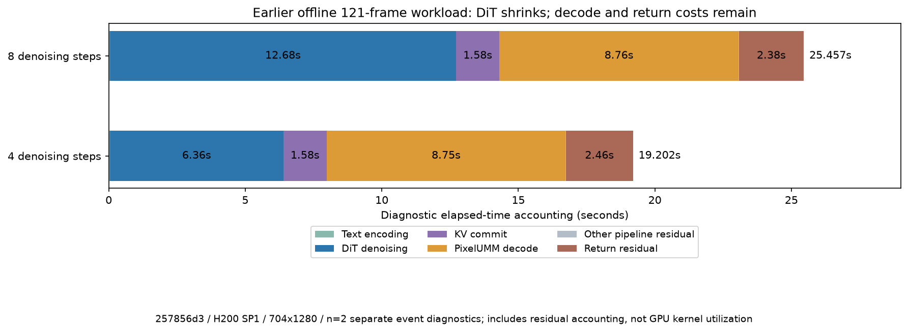

# Model architecture, offline and per-chunk timing, and RFC scope

This supplements the [accuracy, videos and performance report](README.md). No new GPU runs were made for this documentation update. Historical offline and full-history streaming measurements remain separate from the current recent-history qualification.

## Model architecture and parameter accounting

Hy-Nomas combines segment-autoregressive generation with diffusion denoising. Qwen encodes text; a causal dual-stream DiT conditions each segment on text, optional camera geometry and retained KV history; PixelUMM decodes DCAE-V latents into video. The loaded checkpoint is BF16 and distilled for 4/6/8 denoising steps; the integration default remains 8.

| Component | Structure | Parameters | BF16 weight bytes / GiB |
| --- | --- | --- | --- |
| DiT | Dense dual-stream MMDiT; 54 blocks, hidden 2048, 16×128 attention heads, FFN 8192 | 8,553,434,592 ≈8.55B | 17,106,869,184 / 15.93 |
| Text encoder | Qwen2.5-VL-7B language component; 28 layers, hidden 3584 | 7,070,619,136 ≈7.07B | 14,141,238,272 / 13.17 |
| PixelUMM decoder | 36 layers, hidden 4096, 32 query / 8 KV heads; one decoding step | 6,971,793,408 ≈6.97B | 13,943,586,816 / 12.99 |
| Total loaded components | DiT + text encoder + decoder | **22,595,847,136 ≈22.60B** | **45,191,694,272 / 42.09** |

The DiT count includes its token-refinement parameters; the text-model row is the separate Qwen component. The 8.55B figure is not the total loaded model. Counts are BF16 index `total_size/2`, cross-checked with actual loaded component parameter bytes. Runtime memory also includes KV, staging, activations, decoder state and workspaces. [Exact configs and calculations](data/model-structure.json).

DCAE-V representation is `f32t4c32`: 32 latent channels, 32× spatial compression and 4× temporal compression, with DiT patch size 1×1×1. PixelUMM uses 10-latent temporal windows with 5-latent overlap; four output frames are decoded per latent and then cropped. The current API's `4*n+1` validation is a separate restriction. Default geometry is 704×1280 at 24 playback fps, 121 frames, CFG=1, flow shift=5.

## Offline four-versus-eight-step measurement

Earlier implementation **257856d3**, one H200/SP1, resident BF16, eager, 704×1280, 121 frames, seed 42, `output_type=pt`, batch/concurrency=1. Each step count has **10 unprofiled measured requests**: 5 before and 5 after diagnostics, with two initial warmups and one recovery warmup. Model loading, counter RPCs, hashing, encoding and writes are excluded from SDK E2E.

| Denoising steps | Samples | Median E2E (ms) | Mean ± SD (ms) | Before/after median drift | Peak allocated / reserved (GiB) |
| --- | --- | --- | --- | --- | --- |
| 8 | 10 | 25653.8 | 25787.4 ± 555.7 | +0.055% | 59.09 / 63.37 |
| 4 | 10 | 19199.9 | 19202.1 ± 64.1 | −0.396% | 59.09 / 63.37 |

Observed four-versus-eight-step ratio: **1.336×**, E2E reduction **25.16%**. Outputs are deterministic within each step count but differ across step counts; this is not a quality-equivalence claim. The earlier SP/offload benchmark in [README.md](README.md#historical-repeated-sdk-benchmark) is retained as a different dataset, including its −16.91% SP1 drift.

### Offline stage decomposition

Each step count has **two separate CUDA-event diagnostic requests**. Their mean E2E is 25457.4 / 19202.2 ms, not the formal medians above. CUDA-event stream elapsed may include host gaps; it is not pure summed kernel time.

| Stage | 8-step mean (ms) | 4-step mean (ms) | Accounting |
| --- | --- | --- | --- |
| Text encoding | 41.4 | 41.3 | Qwen prompt encoding |
| DiT denoising, all steps | 12682.1 | 6356.5 | 8 / 4 forwards; about 1585.3 / 1589.1 ms per step |
| KV commit | 1583.5 | 1583.8 | One additional noised-context forward |
| PixelUMM decode | 8758.8 | 8750.2 | Covers six logical temporal windows |
| Other pipeline residual | 8.6 | 8.6 | Pipeline scope minus the four measured components |
| Post-pipeline return residual | 2383.1 | 2461.7 | Diagnostic E2E minus pipeline scope; not isolated IPC or PCIe time |

PixelUMM represents **45.57%** of the four-step diagnostic elapsed time. Reducing DiT steps does not remove decode, commit or return costs. Nested wrappers such as `prepare_next_chunk`/text and `pixelumm_window`/decode are not summed twice. Raw observations and recomputed decomposition: [offline-stage-samples.json](data/offline-stage-samples.json), [offline-4-vs-8.json](data/offline-4-vs-8.json).

## Full-history streaming: four individual chunks

Earlier implementation **b5c9b68f5**, one H200/SP1, resident BF16, 704×1280, **253 frames, 4 steps**, 16-latent chunks, explicit capacity **64 latents / 1 prompt**. This is a distinct historical full-history workload, not current recent mode or the default 120-latent/16-prompt capacity. Two complete warmups, five unprofiled baseline sessions, two stage diagnostics; later E2E recheck n=2.

Unprofiled median first-playable frame **7595.3 ms**, E2E **58517.9 ms**, RTF **5.551**. The recheck median was 58292.2 ms (−0.386%). The four chunks emit 24/64/64/101 stable frames; the last includes final flush.

| Chunk | Previous latents | Stable frames | Metadata interval p50 / p95 (ms), n=5 | First decoded frame since request, p50 (ms) | Peak allocated / reserved (GiB), diagnostics |
| --- | --- | --- | --- | --- | --- |
| 0 | 0 | 24 | 7579.4 / 8506.1 | 7595.3 | 114.24 / 117.15 |
| 1 | 16 | 64 | 12671.8 / 13088.2 | 20248.4 | 114.35 / 117.15 |
| 2 | 32 | 64 | 14338.3 / 15764.4 | 34974.2 | 114.35 / 117.15 |
| 3, final flush | 48 | 101 | 23119.5 / 23391.8 | 58157.7 | 114.35 / 117.15 |

Metadata intervals include the inference/encoding/transport chain, and do not equal complete-chunk decoding time. fMP4 may defer one submitted frame until a following fragment or trailer. Sample medians are not additive; nearest-rank p95 with n=5 is the maximum.

### Per-chunk stage decomposition

Two independent event-diagnostic requests, means in ms. Model chunk is worker wall time from `prepare_next_chunk` to `post_decode`; substage columns use CUDA-event stream elapsed.

| Previous latents | Model chunk wall | DiT denoise, 4 forwards | KV commit, 1 forward | PixelUMM prediction | Full decode/convert scope | KV staging, nested |
| --- | --- | --- | --- | --- | --- | --- |
| 0 | 7253.9 | 2581.5 | 655.0 | 2919.8 | 3970.9 | 0.1 |
| 16 | 12261.5 | 3860.9 | 979.8 | 4376.2 | 7148.2 | 4.2 |
| 32 | 14014.1 | 4878.6 | 1229.1 | 4376.7 | 7425.4 | 7.4 |
| 48, final flush | 23091.9 | 5916.8 | 1493.3 | 8749.3 | 13762.5 | 10.7 |

**Do not add nested columns.** PixelUMM prediction is inside full decode/convert, which also includes window assembly, stable-prefix processing, normalization, D2H and uint8 work. KV staging is inside DiT/commit. Event elapsed can contain CPU-induced stream gaps. The `pixelumm_window` wrapper is a batched prediction entry, called 1/1/1/2 times here; this is not a count of individual temporal windows. The final flush changes decode work as well as history length.

Raw data, call counts, baseline and diagnostic samples: [full-stream-253-stages.json](data/full-stream-253-stages.json). The explicit-capacity fixed body was about 109.48 GiB before activations: 42.09 GiB weights + 36.91 GiB KV pool + 30.06 GiB staging + model-owned reserve. The default 120/16 estimate was 172.00 GiB before activations; the single-H200 result does not validate that default.

## Current recent long-stream chunk records

The current implementation's SP2 diagnostics have **45 chunks per 2881-frame session** at history budgets 18 and 36. [current-long-chunks.csv](data/current-long-chunks.csv) publishes all **90 rows**: frame positions, stable/withheld frames, latent progress, history tokens, metadata interval, first/complete decoded-chunk timestamps, and pre-codec hash. The request start is reconstructed from first-decoded timestamp minus the recorded first-playable latency.

| Budget | Early p50 / p95 (ms) | Middle p50 / p95 (ms) | Late p50 / p95 (ms) |
| --- | --- | --- | --- |
| 18 | 12179.2 / 17138.7 | 11417.1 / 13943.7 | 10802.6 / 19439.7 |
| 36 | 11981.8 / 19016.7 | 11745.7 / 13745.2 | 11533.4 / 20295.0 |

Each region has 15 metadata intervals from one diagnostic session; p95 is its maximum. Unlike the earlier regional export, the first interval starts at client request start rather than `video.start` receipt. These are client delivery intervals, not isolated DiT/VAE timing. **No per-stage event timing was collected for these recent rollouts.** Historical full-mode stage values above must not be substituted for current recent stages. [Definitions and exact statistics](data/current-chunk-summary.json).

## Scope relative to RFC #14

The mapping below follows [RFC #14, §5 implementation roadmap](https://github.com/wtz2333/vllm-omni/issues/14), read on 2026-10-29. The RFC is broader than this first integration PR. This is a statement of implemented work and the narrower accepted qualification, not a claim that every RFC checkbox is complete.

| RFC item | Included here | Deferred or not claimed here |
| --- | --- | --- |
| A1: progress, budgets, noise | Separate cumulative positions from resident KV/conditioning/decode state; versioned incremental-v1 sampling; legacy full behavior; model-level reset/release and transaction guards | Complete production lifecycle/resource matrix and broad quality qualification |
| A2: reference rolling PixelUMM | Companion decoder implementation is pinned at reference commit `16a4c228`; Omni consumes it; stable-prefix/default compatibility evidence | It is a reference-package change, not duplicated decoder source in this Omni diff |
| A3: Omni rolling decoder integration | Session-bound decode state, frame positions, empty stable output metadata, normal final flush | Full cancellation/transport lifecycle qualification |
| A4: recent history and 120-second serving | Full/recent modes, shared video/text retention, transactional publication, offline AR, normal realtime/typed output; 18/36 precision and 120+ second delivery evidence | Remaining full A4 service matrix: compute-mid-generation cancellation, real blocked TCP sending, service soak/stress, complete resource high-water accounting; 72 precision and broader W6/full-versus-recent quality |
| B1–B9: performance candidates | No new B-series optimization is claimed; basic SP and module offload remain supported as documented | New media/GPU processing, fused decoder kernels, long-history attention tuning, staging reduction, chunk-residency/prefetch optimization, decode parallelism, encoder sharding, regional compile/graphs and sparse attention |
| C1–C8: history/precision/recovery | Full/recent only, through the existing AR state interfaces | CPU archive, uniform/recent-mix/temporal-context sampling, INT8/QVG KV, INT8 DiT, FP8 decoder, undo and pause/resume |
| D1–D3: interaction extensions | Camera trajectory conditioning is already supported | Nomas-PE integration, official LoRA support and browser keyboard/touch camera UI |

Existing shared runtime cancellation, timeout, quota and backpressure mechanisms remain in use. Excluding their production qualification does not remove them or imply that they were all newly implemented by this PR. The first-PR gate is offline/realtime model integration and full/recent reference accuracy at the declared noise, history, geometry and execution contracts. Current implementation boundaries and video-quality limits in [README.md](README.md#implementation-and-qualification-boundaries) still apply.
